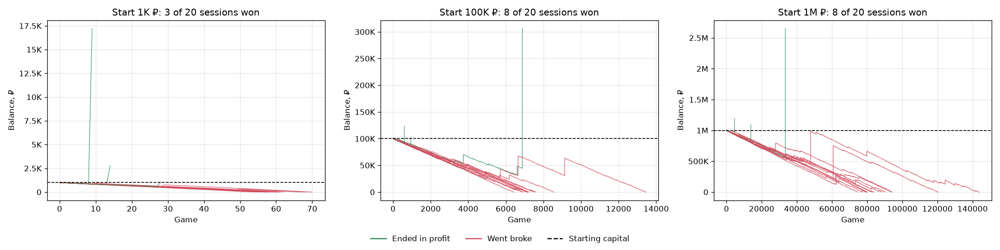
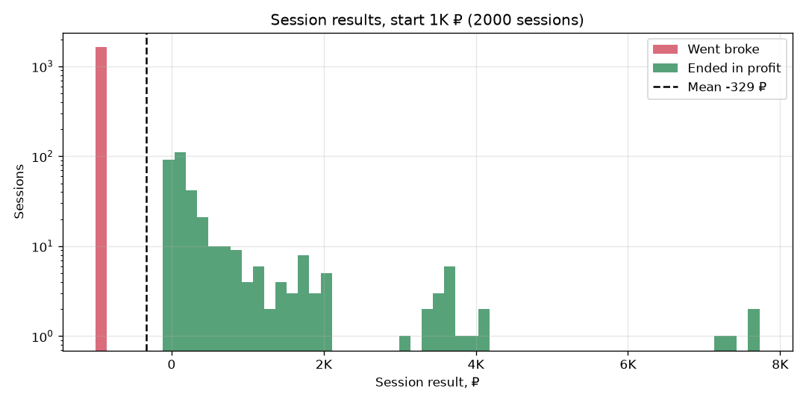
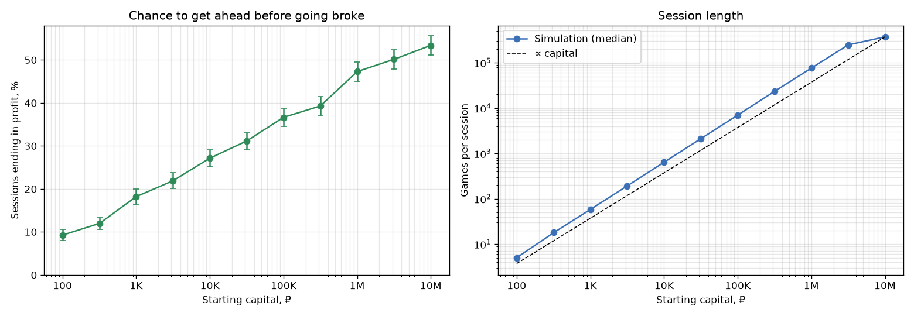
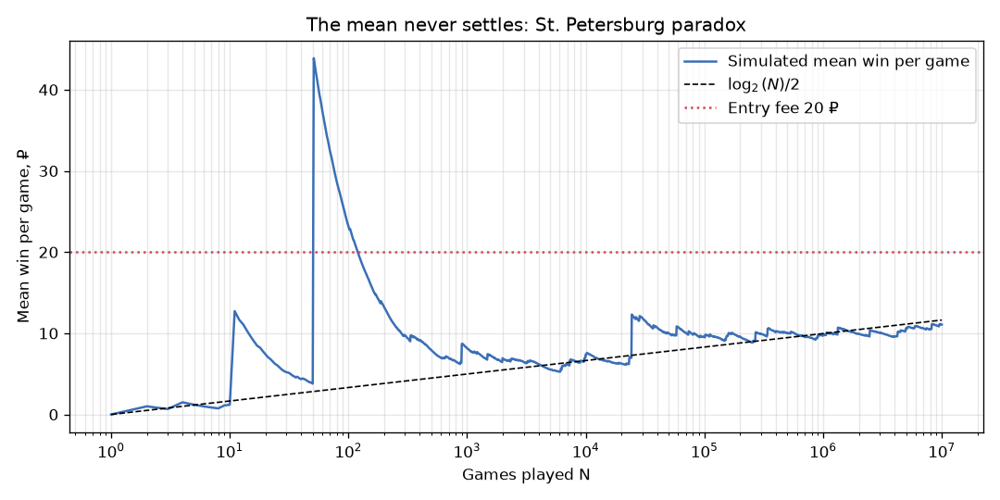

# Монте-Карло: игра в монетку и петербургский парадокс

[](https://github.com/yndarra/stochastic-models-monte-carlo/actions/workflows/tests.yml)


[English](README.md) | **Русский**

Исследование методом Монте-Карло азартной игры с **бесконечным ожидаемым
выигрышем**, которая тем не менее разоряет большинство игроков. Программа
моделирует миллионы игр и показывает, почему игра, «выгодная в среднем»,
плоха для любого игрока с конечным капиталом.



> Курсовая работа по дисциплине «Компьютерное моделирование».

## Игра

* Участие в одной игре стоит **20 ₽**.
* Монетку бросают до первой решки.
* Если перед ней выпало `n ≥ 1` орлов, игрок получает `2ⁿ ₽`; если решка выпала
  сразу — ничего.

Вероятность ровно `n` орлов — `2^−(n+1)`, поэтому ожидаемый выигрыш

```
E[выигрыш] = Σ 2ⁿ · 2^−(n+1) = ½ + ½ + ½ + … = ∞
```

и, если смотреть только на ожидание, любая конечная цена участия кажется
оправданной. Это **петербургский парадокс**. Каждый уровень выигрыша
добавляет к ожиданию всего ½ ₽, а медианный выигрыш равен нулю.

**Стратегия игрока:** начать с капитала `S₀` и играть, пока баланс впервые не
превысит `S₀` (игрок вышел в плюс и уходит) или пока не перестанет хватать
денег на следующую игру (разорение).

## Реализация

Число орлов до первой решки распределено геометрически, поэтому
`numpy.random.Generator.geometric` разыгрывает тысячи игр одним вызовом.
Сессия моделируется векторно, пачками игр. Баланс — накопленная сумма, и
первый индекс, пересекающий одну из границ остановки, завершает сессию. Даже
сессии из сотен тысяч игр считаются за миллисекунды, а всё исследование
(≈ 28 000 сессий и ещё 10⁷ отдельных игр) — примерно за минуту.

## Результаты

### Капитал 1 тыс., 100 тыс. и 1 млн ₽

Цифры ниже получены по 2000 сессий на каждый начальный капитал (seed 42).

| Начальный капитал | Сессий в плюс | Средний итог | Медианная длина сессии |
|---|---|---|---|
| 1 000 ₽ | 18.0% | −329 ₽ | 58 игр |
| 100 000 ₽ | 35.2% | −43 385 ₽ | 6 998 игр |
| 1 000 000 ₽ | 45.1% | −70 031 ₽ | 76 844 игры |

Типичная сессия — медленный и равномерный проигрыш по 20 ₽ за игру, который
изредка прерывается крупным выигрышем. В большинстве сессий выигрыша,
достаточного, чтобы отыграться, так и не случается.



Исход резко бимодален: либо игрок теряет всё, либо выходит в небольшой плюс.
Считаные сессии выигрывают в несколько раз больше начального капитала, и
именно эти редкие выбросы определяют среднее. Поэтому средний итог так сильно
скачет от прогона к прогону.

### Зависимость от начального капитала



Чем больше денег у игрока, тем дольше он может ждать крупного выигрыша.
Вероятность выйти в плюс растёт примерно линейно по *логарифму* капитала: от
9% при 100 ₽ до 53% при 10 млн ₽. Длина сессии растёт почти пропорционально
капиталу.

### Парадокс на одном графике



Выборочное среднее выигрыша за игру не сходится. Оно медленно растёт примерно
как `log₂(N)/2`: чем больше сыграно, тем крупнее самый большой выигрыш,
который успел выпасть. После 10⁷ игр среднее — всего **11.06 ₽** при
`log₂(10⁷)/2 ≈ 11.63`. Чтобы в среднем окупить взнос в 20 ₽, понадобилось бы
около `2⁴⁰ ≈ 10¹²` игр.

## Запуск

```bash
git clone https://github.com/yndarra/stochastic-models-monte-carlo.git
cd stochastic-models-monte-carlo
python -m venv .venv
.venv/Scripts/activate        # Windows; в Linux/macOS: source .venv/bin/activate
pip install -r requirements.txt

python main.py                # все эксперименты (около минуты), картинки — в images/
python main.py capital        # один эксперимент: paths | capital | paradox
python main.py capital --sessions 5000 --seed 7
```

Тесты:

```bash
pip install -r requirements-dev.txt
pytest
```

## Структура проекта

```
coin_game/
├── game.py           # распределение выигрыша, векторное моделирование сессии
├── experiments.py    # статистика по капиталу, траектории, скользящее среднее
└── visualization.py  # графики
tests/                # тесты распределения и правил остановки
main.py               # точка входа (командная строка)
```

## Литература

* [Петербургский парадокс](https://ru.wikipedia.org/wiki/Петербургский_парадокс) — Википедия.
* В. Феллер. *Введение в теорию вероятностей и её приложения*, т. 1, гл. X.4.

## Лицензия

[MIT](LICENSE)
